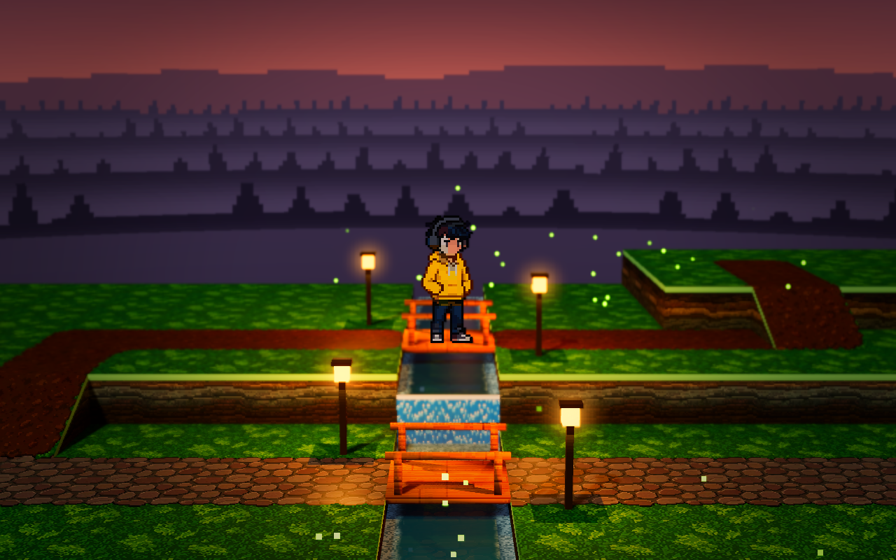

# 四境 · HD-2D｜视频对应历史工程

这是 B 站视频 [《美术资源全 Meowa，代码全 AI：Godot HD-2D 游戏效果展示》](https://www.bilibili.com/video/BV1eQp362ENm/) 对应开发阶段的 Godot 工程，供查看、学习和运行当时的场景效果。



## 打开和运行

1. 使用 **Godot 4.7.2 标准版**，在项目管理器中导入 `demoWithMeowa/1/project.godot`。
2. 等待首次资源导入完成，然后按 **F5**。
3. 默认场景为 `scenes/four_realms.tscn`，可直接控制人物行走。

项目使用 **Forward+** 渲染、Windows **D3D12** 和 Jolt 物理。灯光、体积雾、景深及水面反射需要图形设备支持；无图形界面的检查无法展示这些效果。工程的图像、音频及着色器已包含，无需连接 Meowa 或提供 API 密钥。

| 操作 | 按键 |
| --- | --- |
| 人物移动 | WASD / 方向键 |
| 水平旋转镜头 | Q / E |
| 开关辉光 | G |
| 开关阴影 | H |
| 开关体积雾 | F |
| 切换光照氛围 | L |
| 开关水面反射 | R |

视频路线从出生点出发，向右经过霓虹街道和花草区域，在桥上停留看水后继续到地图右侧。录制时隐藏了 HUD，并使用 2548 × 1320 的窗口；本工程保留历史提交中的正常操作、HUD 和默认窗口设置，因此打开后不会自动播放录制路线。

## 版本来源

- 视频发布日期：**2026-10-11 00:58:49（UTC+8）**。
- 原项目：`Baiiduu/HD-2D`。
- 提取提交：`689cb9371d9c3cc8bcbcbf72ea6777771d07bcf6`。
- 提交时间：**2026-10-10 19:32:47（UTC+8）**。
- 提交说明：`Improve character backlighting and water reflection lighting`。

已与当时录制使用的工程副本核对：场景、美术、光照、水面及镜头代码一致。录制副本额外加入了自动行走控制、调整了输出窗口和视频质量，并有资源导入器生成的参数差异。本目录直接提取 Git 历史提交，不包含这些临时录制设置，也不包含之后加入的战斗、成长或排行榜系统。

## 目录

- `demoWithMeowa/1/`：视频所用的主要 Godot 工程，包括场景、脚本、着色器及美术音频资源。
- `docs/`：该提交已有的灯光、水面和人物受光说明及对照图片。
- `benchmark/`：该提交原有的 Godot / Three.js 对照实验，各自的运行方式见目录内 README；运行主工程不依赖这些实验。

保留了该提交中的全部 446 个文件及原有目录结构；本 README 是为分享补充的说明。开发缓存与原仓库的 Git 历史不包含在此快照中。

## 提取后的检查（2026-10-25）

- 全部 446 个历史文件逐一校验，字节内容与原提交一致；主工程中引用的本地资源均存在。
- 使用 Godot 4.7.2 在独立副本中完成无界面资源导入，随后运行默认主场景 120 帧，退出码为 0，没有脚本错误。
- 首次无界面导入曾在雨声音频处理阶段崩溃；添加 `--single-threaded-scene` 后重试成功。验证命令：

  ```text
  godot --headless --single-threaded-scene --editor --import --path demoWithMeowa/1
  godot --headless --single-threaded-scene --path demoWithMeowa/1 --quit-after 120
  ```

- 运行退出时存在 `6 ObjectDB instances were leaked at exit` 警告，当时的录制日志也有同样警告；为保留历史版本，此处未改动相关代码。
- 本次未重新进行有窗口的画面或音频验收；无界面运行检查不代表对渲染效果的重新确认。
