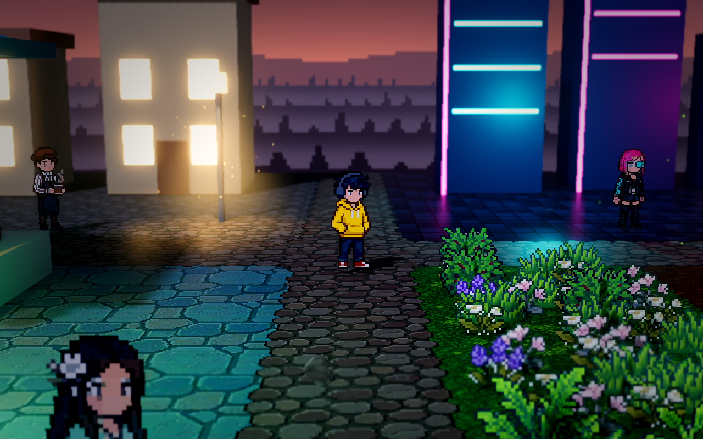

# 四境 · HD-2D｜视频对应历史工程

这是 B 站视频 [《美术资源全 Meowa，代码全 AI：Godot HD-2D 游戏效果展示》](https://www.bilibili.com/video/BV1eQp362ENm/) 对应开发阶段的 Godot 工程，供查看、学习和运行当时的场景效果。

**视频对应的主工程入口：[`demoWithMeowa/1/project.godot`](demoWithMeowa/1/project.godot)**。



上图于 2026-10-25 直接运行本分享仓库的主工程取得：出生点是黄色上衣人物，旁边有青色、紫红色霓虹楼，右侧能看到白色、粉色和紫色花簇。

## 打开和运行

1. 克隆仓库，或下载 ZIP 后**完整解压**；保留 `demoWithMeowa/1/` 下的 `assets`、`scripts`、`shaders`、`data` 和 `scenes`。
2. 打开 **Godot 4.7.2 标准版**的项目管理器，点击“导入”，选择 `HD-2D-ShowCase/demoWithMeowa/1/project.godot`。如果打开的是文件夹，请选择 `demoWithMeowa/1/`。
3. 等待首次资源导入完成。进入编辑器后按 **F5（运行项目）**，会使用默认的 `scenes/four_realms.tscn`。
4. 游戏窗口标题应为 **“四境 · HD-2D”**，调试运行可能附带 `(DEBUG)`；对照上图确认黄色上衣人物、霓虹建筑和花草。按 D 向右走，可经过花草区域到达桥边。

### 避免导入错工程

本仓库保留了历史提交中的对照实验，所以包含两个不同的 Godot 工程：

| 入口 | 用途 | 是否为本视频工程 |
| --- | --- | --- |
| **`demoWithMeowa/1/project.godot`** | 带 Meowa 花草、美术、天气和音频的四境场景 | **是，请导入这个** |
| `benchmark/godot/project.godot` | 名为 `Four Realms HD-2D` 的灯光/渲染对照实验，默认场景为 `scenes/main.tscn` | 否，不能用它核对视频中的花草效果 |

`benchmark/threejs/` 也是独立对照实验。仓库根目录不是 Godot 工程目录；已有项目时请核对项目路径，避免从项目管理器打开了另一个同名历史工程。

**F5 运行项目，F6 运行当前场景。** 核对视频效果请使用 F5；单独运行人物或其他子场景不会加载完整地图和花草。

若打开主工程后仍看不到花草：

- 先核对上表中的完整路径，以及默认场景 `scenes/four_realms.tscn`。
- 确认 `assets/meowa/dressing/assets.json` 和 `assets/meowa/dressing/flowers/flower_01.png` 等图片都已下载，首次导入已完成，并查看编辑器是否有资源加载或脚本错误。
- 使用项目默认的 **Forward+** 渲染设置。切换到 Compatibility 或其他渲染设置后的效果不属于本次核对结果。
- 草花由主场景中的 `World/GroundDressing` 在运行时生成；只查看地面贴图或单独运行地形场景，不能判断花草是否齐全。

也可以在安装了 Godot 命令行的电脑上，从仓库根目录启动：

```text
godot --path demoWithMeowa/1
```

Windows 使用可执行文件完整路径时，例如 PowerShell：

```powershell
& 'C:\Tools\Godot\Godot_v4.7.2-stable_win64.exe' --path '.\demoWithMeowa\1'
```

将示例中的 Godot 安装路径替换为你电脑上的实际路径。

项目使用 **Forward+** 渲染、Windows **D3D12** 和 Jolt 物理。灯光、体积雾、景深及水面反射需要图形设备支持；无图形界面的检查无法展示这些效果。工程的图像、音频及着色器已包含，无需连接 Meowa 或提供 API 密钥。

| 操作 | 按键 |
| --- | --- |
| 人物移动 | WASD / 方向键 |
| 水平旋转镜头 | Q / E |
| 开关辉光 | G |
| 开关阴影 | H |
| 开关体积雾 | F |
| 切换光照氛围 | L |
| 开关水面反射 | R |

视频路线从出生点出发，向右经过霓虹街道和花草区域，在桥上停留看水后继续到地图右侧。录制时隐藏了 HUD，并使用 2548 × 1320 的窗口；本工程保留历史提交中的正常操作、HUD 和默认窗口设置，因此打开后不会自动播放录制路线。

## 版本来源

- 视频发布日期：**2026-10-11 00:58:49（UTC+8）**。
- 原项目：`Baiiduu/HD-2D`。
- 提取提交：`689cb9371d9c3cc8bcbcbf72ea6777771d07bcf6`。
- 提交时间：**2026-10-10 19:32:47（UTC+8）**。
- 提交说明：`Improve character backlighting and water reflection lighting`。

已与当时录制使用的工程副本核对：场景、美术、光照、水面及镜头代码一致。录制副本额外加入了自动行走控制、调整了输出窗口和视频质量，并有资源导入器生成的参数差异。本目录直接提取 Git 历史提交，不包含这些临时录制设置，也不包含之后加入的战斗、成长或排行榜系统。

## 目录

- `demoWithMeowa/1/`：视频所用的主要 Godot 工程，包括场景、脚本、着色器及美术音频资源。
- `docs/`：该提交已有的灯光、水面和人物受光说明及对照图片。
- `benchmark/`：该提交原有的 Godot / Three.js 对照实验，各自的运行方式见目录内 README；运行主工程不依赖这些实验。

保留了该提交中的全部 446 个文件及原有目录结构；本 README 和 `docs/showcase-running.png` 是为分享补充的启动说明与实机截图。开发缓存与原仓库的 Git 历史不包含在此快照中。

## 提取后的检查（2026-10-25）

- 全部 446 个历史文件逐一校验，字节内容与原提交一致；主工程中引用的本地资源均存在。
- 使用 Godot 4.7.2 在独立副本中完成无界面资源导入，随后运行默认主场景 120 帧，退出码为 0，没有脚本错误。
- 首次无界面导入曾在雨声音频处理阶段崩溃；添加 `--single-threaded-scene` 后重试成功。验证命令：

  ```text
  godot --headless --single-threaded-scene --editor --import --path demoWithMeowa/1
  godot --headless --single-threaded-scene --path demoWithMeowa/1 --quit-after 120
  ```

- 运行退出时存在 `6 ObjectDB instances were leaked at exit` 警告，当时的录制日志也有同样警告；为保留历史版本，此处未改动相关代码。
- 后续直接从本分享仓库完成 D3D12 / Forward+ 有窗口启动，并检查了出生点实机截图：白、粉、紫色花簇与绿色草丛均可见。截图见本文顶部；未进行完整游玩及音频验收。
