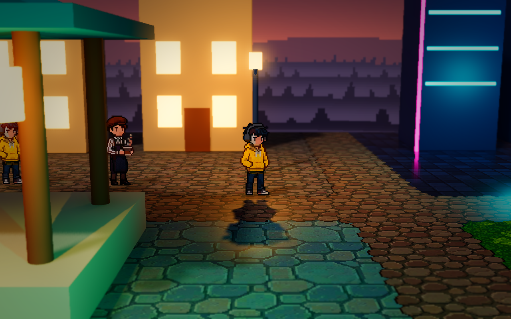
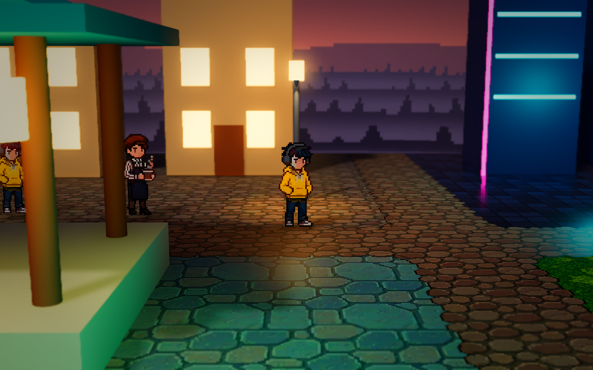
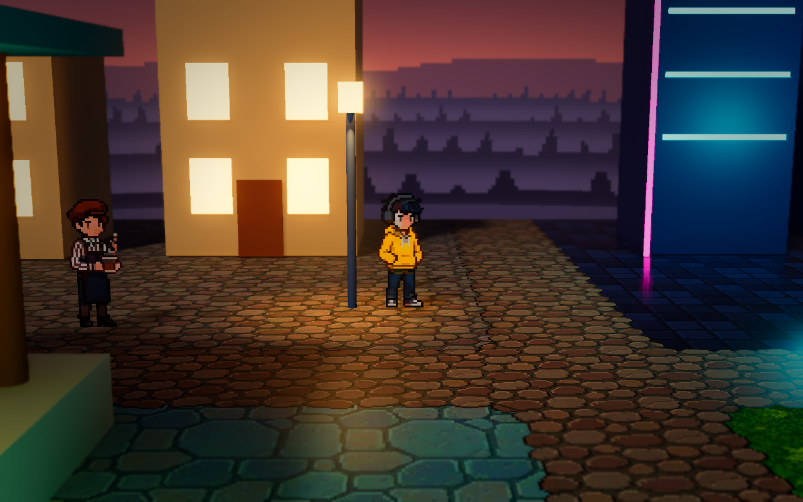
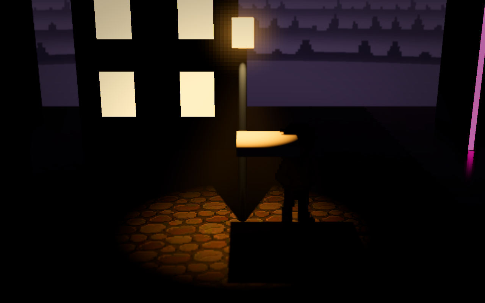
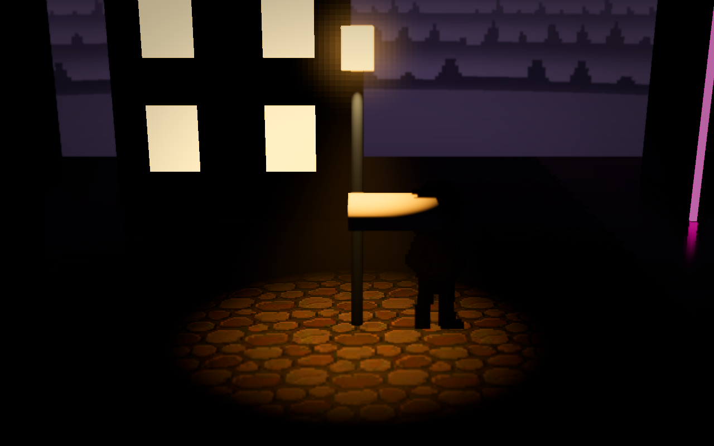

# 城市锥形光与真实阴影

> 这是首轮集成的历史记录。随后实际运行 three.js 对照后的新版效果、参数和性能，见 [锥形灯参考对照](cone-light-reference-match.md)。

2026-10-10，集成到 `demoWithMeowa/1`。水面集成版本已作为 `6b06564` 推送到 GitHub；本文记录随后在本地实现的路灯改动。

## 从 three.js 提取了什么

`benchmark/threejs/src/lights.js` 用 SpotLight 提供聚光照明，再叠加透明、加法混合的锥形网格，让光束在空气中可见。锥体有侧面、距离和底部淡出；它本身不采样灯光阴影。该版 SpotLight 没有开启 castShadow，真实局部阴影主要来自按人物距离选择的最多四盏 PointLight，另有月光阴影。

这次采用其柔边光束、暖色聚光和灯下明暗分区，但在 Godot 用 **SpotLight3D + 局部 FogVolume + 原生阴影贴图** 实现遮挡。新 fog shader 只写密度和散射色，不写发光颜色；地面照明与空气中的光束使用同一盏真实灯，物体可以同时阻挡它们。开启灯具尺寸 0.08 的 PCSS 软阴影，不增加全屏散射后处理或新的反射视图。

## 修正与设置

- 两盏城市路灯原来的聚光灯运行时朝上，已修正为竖直向下。
- 出光点从灯具内部移到灯罩下方、灯杆前方：相对灯节点 `(0, -0.14, 0.18)`。发光灯罩关闭投影，灯杆保留投影，避免把整束光封在不透明灯具里面。
- 聚光灯加入 `shadow_lights`，开启真实阴影；bias 0.03、normal bias 0.8，保留项目已有的高质量阴影过滤。
- 椭球灯雾改为 3.4 × 2.36 × 3.4 m 范围内的柔边锥形密度。顶部窄、向下展开，顶部与落地处渐隐；原有全局雾和瀑布雾保持原设置。
- 全向补光从 2.7 降至 1.2，关闭这两盏全向灯对体积雾的散射，让聚光阴影更容易分辨。灯光射程与整体曝光保持原值。

运行主场景，往城市路灯下走。**H** 切换所有灯光阴影，**F** 切换体积雾，**R** 切换水面反射。关闭雾后保留聚光照明和地面阴影。

`ArtDirection` →「灯光与后处理」可以在检查器中调整：

| 参数 | 默认值 | 用途 |
|---|---:|---|
| cone_enabled | true | 两盏城市路灯的聚光与局部锥形雾总开关 |
| cone_energy | 4.0 | 聚光照明亮度 |
| cone_scattering | 6.0 | 空气中光束的亮度 |
| cone_density | 0.07 | 锥形雾密度 |
| cone_shadow_size | 0.08 | PCSS 灯具尺寸；设为 0 可减轻软阴影开销 |
| street_fill_energy | 1.2 | 路灯全向补光 |

默认效果较克制，明亮的建筑立面会降低光束对比。需要更接近 three.js 的显眼光锥时，优先提高 cone_scattering；提高密度也会遮住背景。当前只应用到参考版的两盏城市路灯，没有把所有彩色灯改成聚光灯。

## 验证与性能

基线为 GitHub 水面提交后的完整场景，包括原有水面反射。Godot **4.4.1 / D3D12 / Forward+ / RTX 3050 Laptop GPU**，1280 × 800，关闭垂直同步和帧率上限。每个机位先等待物理落地、固定相机、预热 180 帧，再测约 3 秒；六个机位和前后场景分别运行，避免 GPU 相互竞争。首次 shader/PSO 编译不计入稳定帧率。

| 人物位置 x,z | 替换前 FPS | 替换后 FPS | 替换后 P95 帧时间 ms |
|---|---:|---:|---:|
| 0,1.4 | 157.7 | 155.7 | 6.884 |
| -2.4,-0.6 | 156.5 | 153.7 | 6.962 |
| 6,3 | 162.1 | 159.2 | 6.785 |
| 22.4,2.5 | 164.6 | 164.4 | 6.539 |
| 28,-4.8 | 181.3 | 179.4 | 5.989 |
| -1.8,-2.4 | 158.5 | 156.2 | 6.824 |

城市路灯机位 FPS 下降约 1.8%，帧时间中位数从 6.419 增至 6.528 ms。其他机位的微小差异也包含测试波动，不能据此保证不同显卡、分辨率或新增大量路灯时的开销。

专门的遮挡验证关闭其他灯光、间接光与泛光，保留一盏聚光灯，加入悬空不透明小板。仅切换这盏灯的阴影，比较相同图像区域：地面平均 RGB 亮度从 0.20084 降至 0.00035，空气区域从 0.05259 降至 0.03653。遮挡物和相机位置均保持不变，证明效果包含实际阴影与体积雾遮挡。

另外使用用户安装的 **Godot 4.4 原版**进行了无窗口主场景启动及 D3D12 实际 GPU 验证。人物沿预设路径移动、跟随相机更新时，城市路灯路径帧时间中位数 6.140 ms / P95 6.736 ms，水面路径 5.951 ms / P95 6.512 ms；检查了活跃镜像相机的水位变换、R 反射切换、H 全部灯光阴影切换和 F 体积雾切换，断言全部通过。这是移动视角与渲染检查，人物位置由测试脚本驱动，不替代完整碰撞玩法测试。

检查器 cone_enabled 开关也通过运行时断言。最终日志没有脚本或 shader 错误；D3D12 仅出现引擎已有的 PSO 缓存未实现警告。测试脚本、日志和中间截图位于 `E:/CodexData/hd2d-cone-light-20261010`，不混入游戏工程。

## 对比截图

正常场景替换前：

正常场景替换后：

灯下近一点的默认机位：

以下为**隔离单盏灯的验证画面**，不代表游戏默认亮度。悬空小板和人物遮挡空气光束，并在地面形成阴影：

关闭该灯阴影后，原来被挡住的地面和空气重新受光：

## 当前限制

这是阴影贴图和体积雾散射，没有加入光线追踪。人物仍然是二维 Sprite3D，影子依据面片与透明轮廓投射，不具备完整三维人物的体积；竖直光照下的面片影子与实体网格不同。Godot 官方还说明，billboard 投影在多相机场景中存在方向歧义，本次没有重写整套角色投影系统。局部光束在低分辨率雾网格和移动相机下仍可能出现轻微颗粒、时间重投影拖尾；没有增加全局雾网格分辨率来强行消除这些现象。

实现依据：[Godot 4.4 体积雾](https://docs.godotengine.org/en/4.4/tutorials/3d/volumetric_fog.html)、[Fog shader](https://docs.godotengine.org/en/4.4/tutorials/shaders/shader_reference/fog_shader.html)、[Light3D 软阴影与灯具尺寸](https://docs.godotengine.org/en/4.4/classes/class_light3d.html)、[SpriteBase3D billboard 投影说明](https://docs.godotengine.org/en/4.4/classes/class_spritebase3d.html)。
