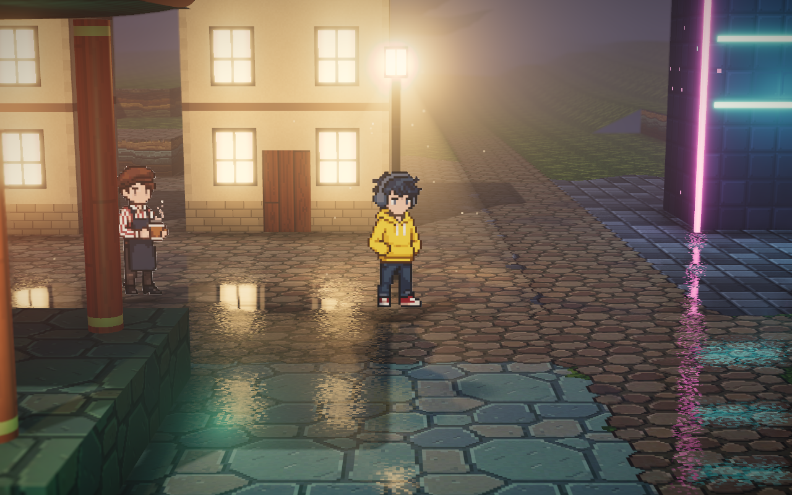
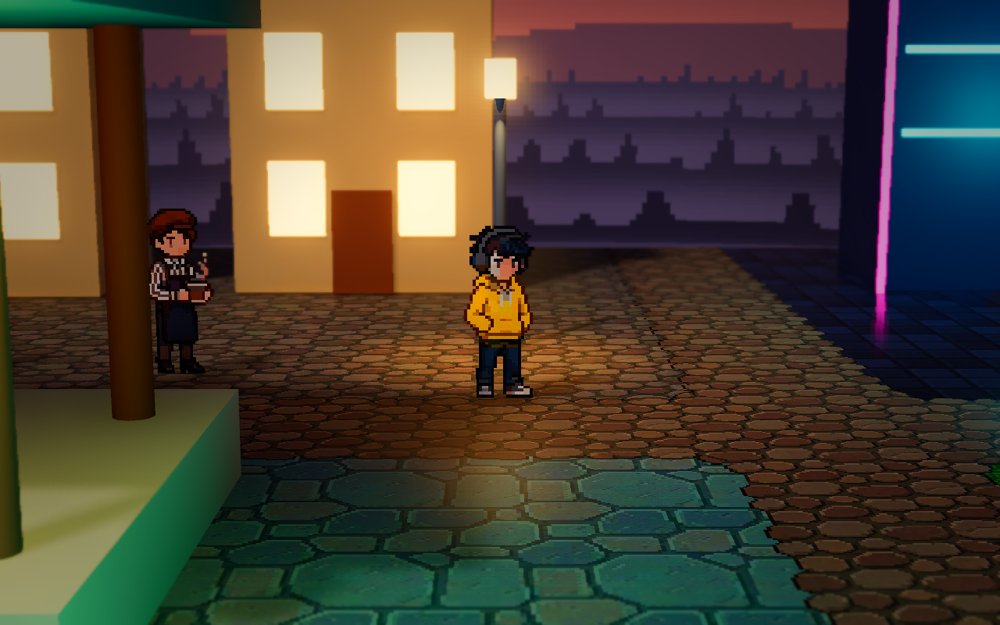
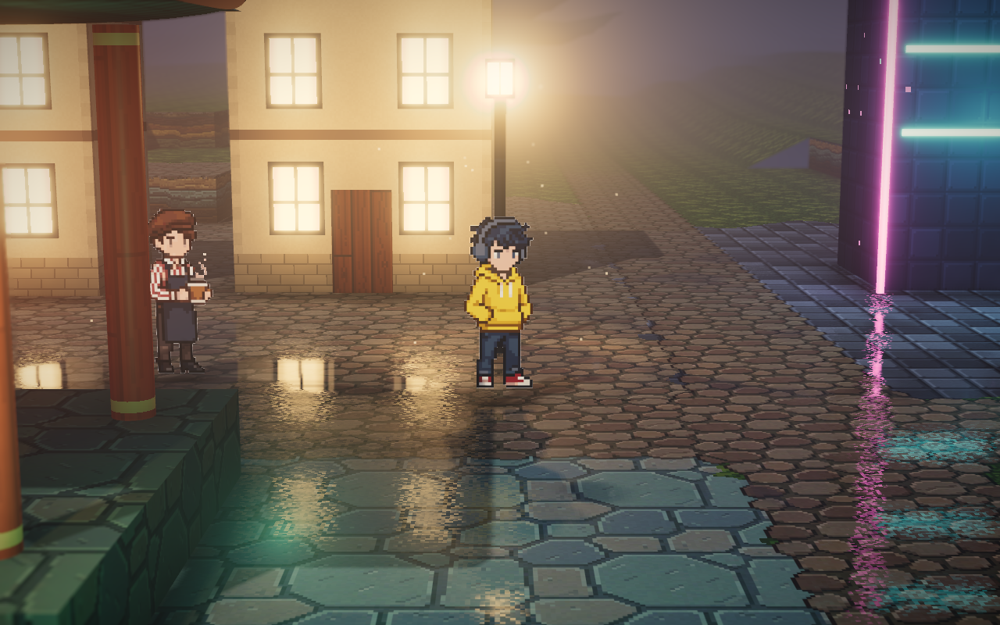
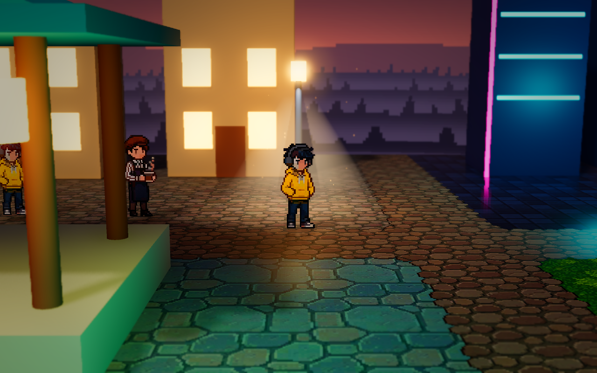
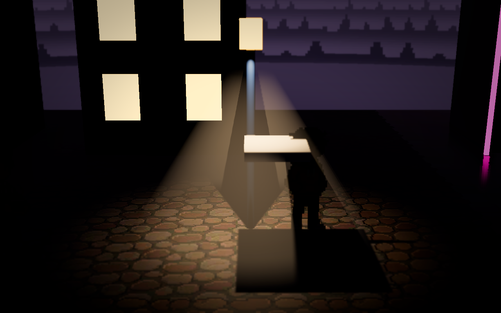
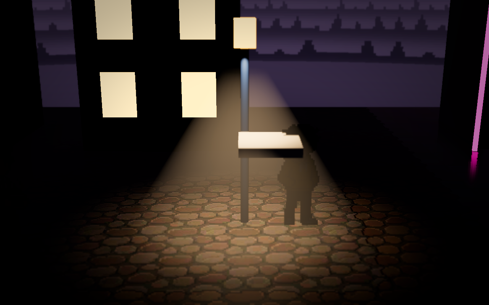

# 实跑 three.js 后的锥形灯对照

2026-10-10。在 Edge / ANGLE D3D11 / RTX 3050 Laptop GPU 实际运行仓库的 three.js 0.170.0，加载完整场景和贴图，渲染后保存画面；不是使用旧截图推测效果。城市、灯下和路口三处均完成捕获，没有页面错误或资源请求失败。现有 WebGL shader 编译警告记录在测试日志中。

## 实际差异

参考版同时使用四种表现：灯头的明亮核心与宽光晕、独立加法混合锥面、空气散射后处理、稀疏光尘。关闭它的两张锥面后，三角光束消失，而灯头周围的散射光仍然很强，说明仅增强 Godot 的体积雾不够。

Godot 首版的纯体积雾光束过弱，灯头光晕中心被实体灯罩深度遮挡。此次保留真实聚光阴影，同时补齐轮廓和灯头表现：

- 城市灯头采用参考的指数核心与宽光晕，直径 1.6 m，向镜头偏移 0.3 m，单独亮度 1.25。其他灯笼维持原光晕。
- 增加高 2.36 m、底半径 1.6 m 的柔边锥面；使用参考的视角渐隐、纵向衰减和底部淡出，并增加与地面或建筑交界处的深度淡出。
- 锥面使用独立的第 18 渲染层，只由城市聚光灯照亮。它不是自发光材质，接收原生灯光阴影；月光和全向补光不会把被挡住的锥面重新照亮。水面镜像继续排除空气雾和光束增强面，保留灯头光晕。
- 为照亮带顶部半径的锥面，将聚光角度由 36° 调为 48°；视觉锥面仍维持约 1.6 m 的底半径。聚光色改为更淡的暖色 `(1, 0.92, 0.82)`，避免高饱和度调色把光束推成橙色块。
- 体积雾散射由 6 增至 18，局部密度由 0.07 增至 0.10。没有改变全局曝光、调色、相机或雾网格分辨率。
- 每盏路灯增加 22 个缓慢漂浮的光尘。光尘也接收原生灯光与阴影，关闭雾或禁用锥形灯时立即隐藏。

## 对照画面

以下画面都使用人物位置 `(-2.4, -0.6)`、1280 × 800、25° 视场角、10° 俯角、11 m 相机距离。Godot 的 25° 只用于对照截图，游戏默认仍为 30°。两个版本的材质、天空、调色和人物尺寸仍不同，不能把整张图的差异全部归因于灯光。

three.js 实跑：

Godot 首版：

Godot 本次调整：

参考版关闭独立锥面，仍保留灯头散射、光晕和光尘：

Godot 游戏默认 30° 视角：

## 遮挡与开关验证

在用户安装的 **Godot 4.4 原版 / D3D12 / Forward+** 实跑验证。关闭体积雾、其他灯光和光晕，保留聚光灯与增强锥面，在灯下加入悬空小板；仅切换该灯的阴影，增强锥面也会变暗。相同区域平均 RGB 亮度，空气区域从 0.3773 降至 0.3125，地面区域从 0.4162 降至 0.2116。开启体积雾后也通过相同遮挡检查。

以下是隔离单灯验证，不是游戏默认亮度：

| 开启阴影 | 关闭阴影 |
|---|---|
|  |  |

H 阴影、F 雾与光束/光尘、R 水面反射的运行时检查通过。两个光束网格保持在第 18 层，没有泄漏到第 19/20 层水面镜像。最终 Godot 日志没有脚本或 shader 错误，只有引擎已有的 D3D12 PSO 缓存警告。

## 新增开销

Godot 4.4 / D3D12 / RTX 3050 Laptop GPU，1280 × 800 默认 30° 视角，关闭 VSync 和帧率上限。完整六机位启动检查通过；检测到后台应用 GPU 负载变化后，性能结论改用同一进程、同一机位的「旧版 → 新版 → 旧版」交替测量。每轮预热 180 帧，再采样约 3 秒，排除首次编译。

| 机位 | 旧版首次 FPS | 新版 FPS | 旧版复测 FPS | 新版 P95 ms |
|---|---:|---:|---:|---:|
| 城市路灯 -2.4,-0.6 | 159.1 | 154.4 | 158.7 | 7.044 |
| 水面 22.4,2.5 | 169.4 | 169.0 | 168.6 | 6.424 |

相对于两次旧版的平均值，路灯机位 FPS 下降约 **2.8%**，帧时间中位数增加约 **0.16 ms**；水面机位处于两次旧版的波动范围内。这里只新增两盏灯的表现，不能按此保证大量光束重叠或更高分辨率时的开销。需要减轻开销，可先设 `cone_shape_gain = 0`，保留原生雾与地面阴影。

## 调整参数

在 `ArtDirection` →「灯光与后处理」调整：

| 参数 | 默认值 | 用途 |
|---|---:|---|
| cone_shape_gain | 0.18 | 清晰光锥轮廓的强度；设 0 隐藏增强锥面，减轻透明阴影着色开销 |
| cone_scattering | 18 | 空气散射亮度 |
| cone_density | 0.10 | 局部雾浓度 |
| street_halo_energy | 1.25 | 城市灯头光晕强度 |
| street_dust_enabled | true | 城市光尘开关，每盏 22 个 |
| cone_shadow_size | 0.08 | 原生 PCSS 软阴影灯具尺寸 |

这是采用真实阴影的表现层组合。增强锥面是在其表面采样灯光阴影，体积雾负责空气内部的遮挡；它并非逐步积分整束空气的物理渲染，细小遮挡形态仍有近似。全场景的湿地反射、建筑材质与总体色调没有在本次同步迁移。

源代码依据为 `benchmark/threejs/src/lights.js`、`post.js` 和 `particles.js`。原生接收阴影使用 Godot 4.4 的 [light() 与 ATTENUATION](https://docs.godotengine.org/en/4.4/tutorials/shaders/shader_reference/spatial_shader.html)。测试脚本、原始截图及日志在 `E:/CodexData/hd2d-cone-match-20261010`。
