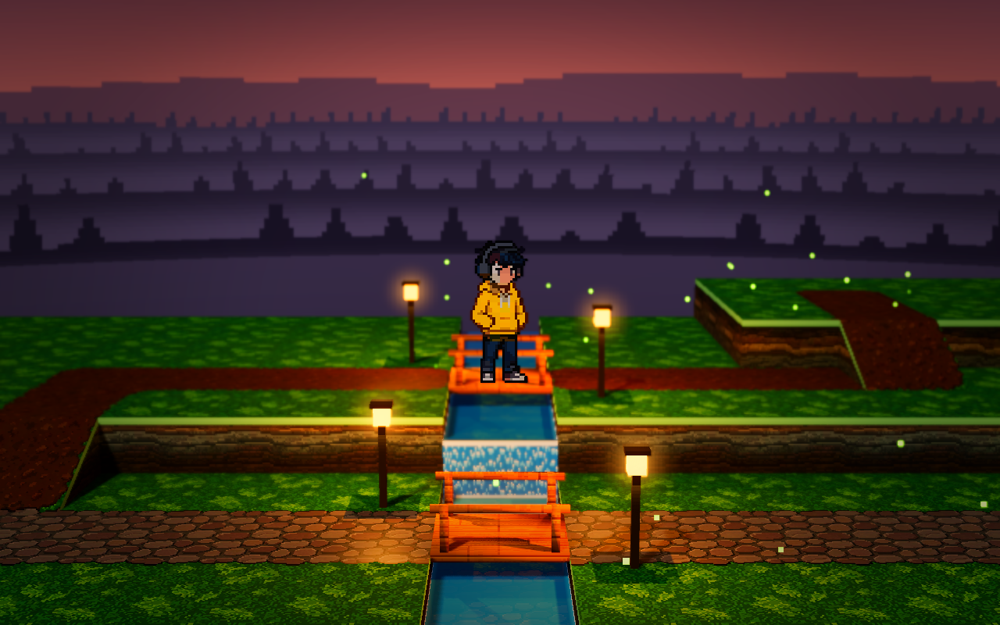
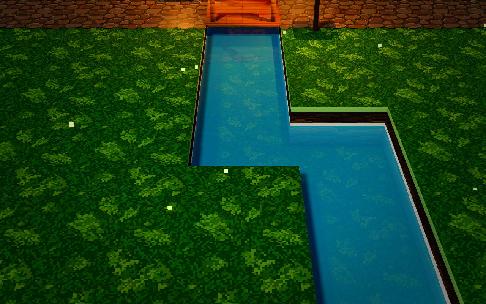
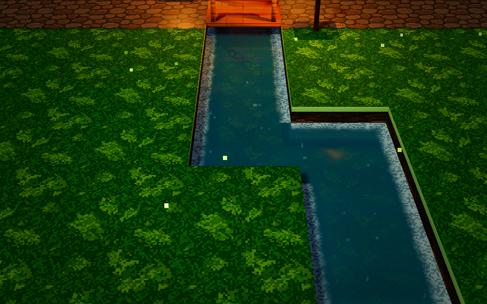
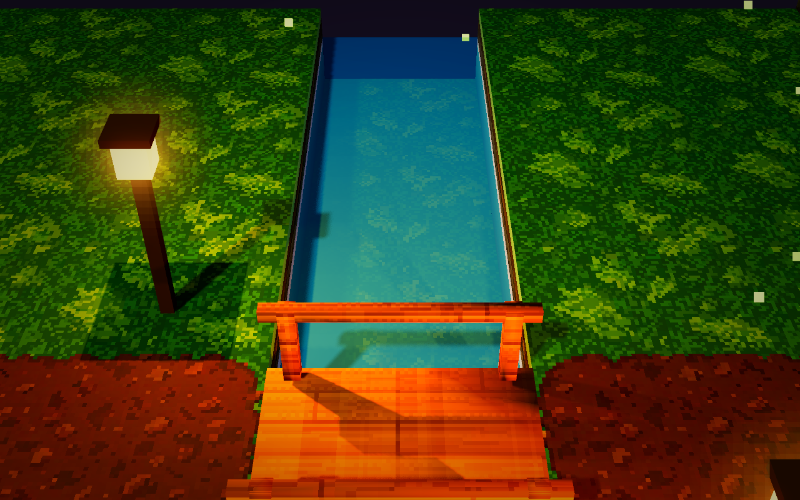
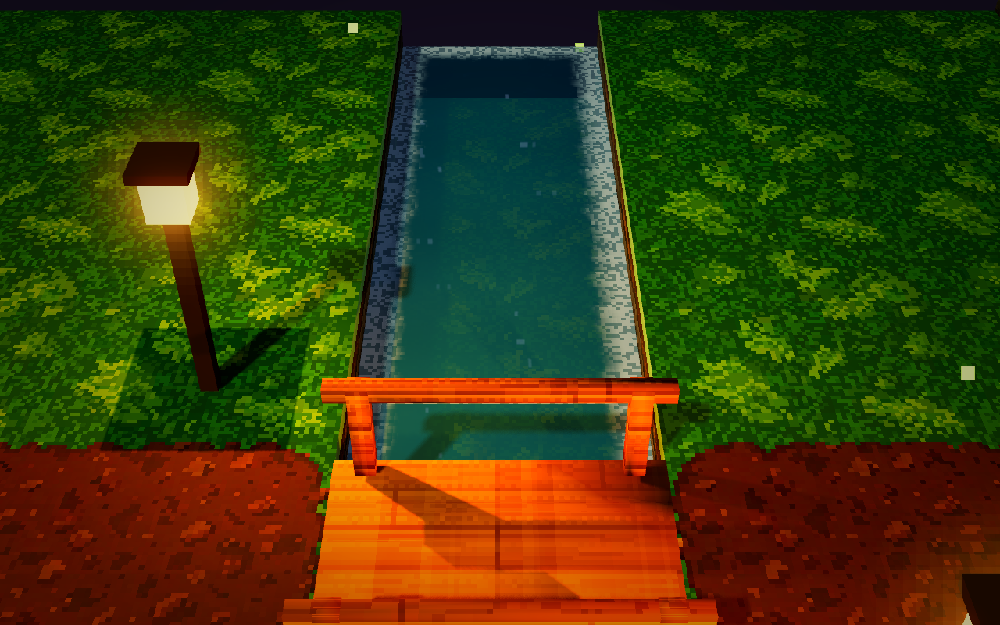

# 水面与平面反射集成结果

2026-10-09～10，集成到 `demoWithMeowa/1`。Godot 4.4.1、Forward+，无需额外插件。水面运行时默认启用平面反射。

## 画面变化

- 两相交叉混合的像素纹理流动，配合轻微动态法线，避免流动周期重置时跳变。
- 深浅水色、贴岸的像素泡沫、瀑布落点的扰动泡沫，保留深度交界泡沫。
- 下游 -0.32 m、上游 0.48 m 分别使用镜像相机；同一高度的水块共享反射，两个水位同时可见时最多渲染两张视图。
- 反射保留灯头、光晕、桥和人物；水面/瀑布不进入镜像，避免递归采样。静态网格在加载时按水位裁剪，人物使用带水位裁剪的反射面片。
- 镜像使用 HDR 纹理，关闭自身的 bloom、色调调整、景深、SSR、SSAO、SSIL、SDFGI 和体积雾，最终反射由主画面的后处理统一处理。

默认机位的水面占画面较少，变化主要体现在水色、岸线和桥下倒影。近景更容易看到水纹和反射细节；当前河道较窄，岸上的灯并不会在任何机位都产生完整倒影。未调整灯的位置、跟随相机或整体色彩设定，也未更改瀑布材质。

## 查看与调整

在 Godot 打开 `demoWithMeowa/1/project.godot`，运行主场景，到东侧河道查看。按 **R** 切换水面反射；关闭时保留新的水纹、泡沫和法线。

`ArtDirection` 检查器新增水面设置，运行时生效：

| 设置 | 默认值 | 用途 |
|---|---:|---|
| water_reflection_enabled | true | 反射总开关 |
| water_reflection_scale | 0.5 | 宽高各为主视图的一半；1280×800 时为 640×400 |
| water_reflection_strength | 0.85 | 反射强度，仍受 Fresnel 和泡沫抑制 |
| water_wave_strength | 0.08 | 动态法线和倒影扰动 |

性能吃紧时可先将 scale 调到 0.35，或关闭反射。提高分辨率只增加倒影细节，不增加水位数量。镜像只在对应水面与相机视锥相交时更新；该判断不会检查水面是否被另一座建筑完全遮住。

命令行在 `--` 后添加 `--no-reflection` 可关闭反射，已有 `--capture` / `--at` 功能继续可用。编辑器静止预览不运行反射控制节点，请以运行画面为准。

## 实测性能

同一台 RTX 3050 Laptop GPU，Godot 4.4.1 / D3D12 / Forward+，主视图截图 1280×800，反射视图 640×400，关闭垂直同步和帧率限制。每个机位完成物理落地、相机定位和预热后采样约 3 秒。

“原水面”是在同一集成场景中换回 Git 基线的水面 shader/default 参数并关闭镜像；“新水面”开启新材质和按可见性更新的反射。它们用于隔离这次水面改动的效果。小于几个百分点的波动不应理解为速度提升。首次 shader/PSO 编译未计入稳定帧率。

| 机位 x,z | 原水面 FPS | 新水面 FPS | 活跃反射视图 | 新水面 P95 帧时间 ms |
|---|---:|---:|---:|---:|
| 0,1.4 | 165.5 | 167.2 | 0 | 6.290 |
| -2.4,-0.6 | 164.3 | 165.5 | 0 | 6.512 |
| 6,3 | 169.9 | 173.3 | 0 | 6.120 |
| 22.4,2.5 | 193.4 | 176.2 | 2 | 6.254 |
| 28,-4.8 | 207.9 | 194.3 | 1 | 5.729 |

两个有水机位的 FPS 分别下降约 **8.9%**、**6.5%**；在本机仍有充足的 60 FPS 余量。保留新材质而关闭反射时，这两个机位为 194.6 / 206.3 FPS。相机连续跟随穿过河道区域的 480 帧测试，中位帧时间 5.760 ms、P95 6.111 ms；该测试通过脚本移动目标，覆盖相机与反射更新，不是完整玩家碰撞测试。结果仅代表此机器和当前场景，不是其他设备或更复杂场景的帧率保证。

## 已执行的检查

- Godot 4.4.1 全量导入和基础运行通过；Vulkan 和默认 D3D12 均实际渲染并检查截图。
- 五个固定机位：原水面、新水面、新水面关闭反射，共 15 张 D3D12 截图，水外三个机位的活跃镜像数为 0。
- 所有用于反射的裁剪网格顶点都位于对应水位之上，主相机不渲染这些反射专用网格。
- 上下水位分别放置临时发光标记物，按世界坐标计算准确倒影位置。D3D12 两次检查的预期像素为 (640,394)、(640,382)，各自 9×9 检查区内 81 个像素都检出标记色；标记只存在于临时测试场景。
- 连续移动时镜像相机高度匹配对应水位，R 键处理函数可关闭并重新开启镜像。
- 正常主场景启动与 `--no-reflection` 启动均完成 D3D12 截图；R 开关与 ArtDirection 设置保持一致，重新应用美术参数不会意外恢复已关闭的反射。命令行关闭仅设置初始状态，随后仍可按 R 开启。
- 未发现解析、shader 编译或运行错误。D3D12 日志保留 Godot 4.4.1 原有的“PSO caching is not implemented”警告。

原始日志、结果 JSON、校验脚本和全部截图位于 `E:/CodexData/hd2d-water-integration-20261009/`。

## 对比截图

同一组前后截图保持相机、环境与布局一致。萤火虫位置和水纹时间没有固定，截图用于视觉检查，不用于逐像素差分评分。

默认桥边机位：

下游细节，临时近景相机、关闭景深：

上游细节，临时近景相机、关闭景深：

## 当前适用范围

静态网格的裁剪和图层分配只在场景加载时生成，适合当前 demo。将来新增会移动的 MeshInstance3D、运行时编辑地形或新增第三种水位时，需要扩展反射几何更新；当前动态人物贴图会同步位置、贴图和翻转。反射面片按当前单帧、居中、固定 Y 轴的角色贴图配置实现，未来角色动画图集需要同步尺寸和帧 UV。

图层 19/20 供镜像使用。主场景中原有几何、光照、碰撞与角色移动继续使用原来的节点；仅在运行时增加反射专用几何。暂未把反射集成到道路或地面材质。

## 主要实现入口

- `demoWithMeowa/1/scripts/planar_water_reflection.gd`：水位分组、按视锥更新、静态几何裁剪、镜像相机、人物反射同步。
- `demoWithMeowa/1/shaders/water.gdshader`：水流、岸线/落点泡沫、深浅色、法线、Fresnel 和反射采样。
- `demoWithMeowa/1/shaders/reflection_sprite.gdshader`：人物反射的 billboard 与水位裁剪。
- `demoWithMeowa/1/scripts/art_direction.gd`：水面质量与强度设置。

技术依据：[Godot 4.4 Viewport 的 HDR 纹理与颜色空间](https://docs.godotengine.org/en/4.4/classes/class_viewport.html#class-viewport-property-use-hdr-2d)、[空间 shader 的相机图层与坐标](https://docs.godotengine.org/en/4.4/tutorials/shaders/shader_reference/spatial_shader.html)。
